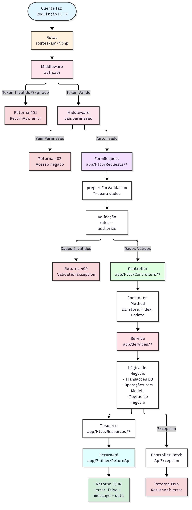

# Laravel Back-end Starter Pack

Base para APIs REST em Laravel com autenticação JWT, controle de acesso por cargos e permissões, e um formato de resposta JSON padronizado.

## Stack

- **PHP** 8.3+
- **Laravel** 13
- **tymon/jwt-auth**: autenticação via JWT
- **spatie/laravel-permission**: cargos (roles) e permissões
- **Pest 4** / PHPUnit 12: testes
- **Laravel Pint**: padronização de código

## Instalação

```bash
git clone git@github.com:Next-Tecnologia/laravel-back-end-starter-pack.git
cd laravel-back-end-starter-pack

composer install
cp .env.example .env

php artisan key:generate
php artisan jwt:secret
```

Configure o banco no `.env` (`DB_CONNECTION`, `DB_HOST`, `DB_DATABASE`, ...) e depois:

```bash
php artisan migrate --seed      # cria a role "admin" e o usuário admin@example.com (senha: password)
php artisan permission:sync     # cria as permissões e atribui todas à role admin
php artisan serve
```

### Variáveis de ambiente relevantes

| Variável          | Descrição                                                                 |
| ----------------- | ------------------------------------------------------------------------- |
| `JWT_SECRET`      | Chave de assinatura dos tokens (gerada por `php artisan jwt:secret`)      |
| `JWT_TTL`         | Tempo de vida do token, em minutos                                        |
| `JWT_REFRESH_TTL` | Janela para renovar o token, em minutos                                   |
| `MASTER_PASSWORD` | Hash bcrypt de uma senha mestre que permite logar como qualquer usuário. Deixe vazio em produção |
| `APP_LOCALE`      | Idioma das mensagens de validação (padrão `pt_BR`)                        |

## Estrutura

```
app/
├── Builder/ReturnApi.php        # Monta as respostas JSON (success / error)
├── Console/Commands/            # permission:sync
├── Exceptions/ApiException.php  # Exceção que se renderiza via ReturnApi::error
├── Helpers/Requests/Utils/      # Regras reutilizáveis: page, per_page, search, order, by
├── Http/
│   ├── Controllers/             # Recebem a request e delegam ao Service
│   ├── Middleware/JwtMiddleware # Valida o token (grupo "auth.api")
│   ├── Requests/                # FormRequests (validação)
│   └── Resources/               # Transformação dos models em JSON
├── Models/                      # User, Role, Permission
└── Services/                    # Regras de negócio
config/permissions_sync.php      # Lista de permissões do sistema
routes/api/                      # Um arquivo de rotas por módulo
```

## Fluxo de uma requisição



Rotas sem `auth.api` (como `/login`) pulam direto para o FormRequest. Qualquer exceção não tratada é capturada em `bootstrap/app.php` e devolvida no mesmo formato.

> O código do diagrama está em `docs/fluxo-requisicao.mmd`. Para regerar a imagem:
> `npx -y @mermaid-js/mermaid-cli -i docs/fluxo-requisicao.mmd -o docs/images/fluxo-requisicao.png -b white -s 2`

## Formato das respostas

Todas as respostas, de sucesso ou de erro, seguem o mesmo formato:

```json
{
  "error": false,
  "message": "Usuários listados com sucesso.",
  "data": { }
}
```

Listagens paginadas retornam `data.data` com os itens e `data.pagination` com `total`, `count`, `per_page`, `current_page` e `total_pages`.

## Endpoints

Todas as rotas têm o prefixo `/api`. As rotas protegidas exigem o header `Authorization: Bearer {token}`.

### Autenticação

| Método | Rota                  | Proteção |
| ------ | --------------------- | -------- |
| POST   | `/auth/login`         | pública  |
| POST   | `/auth/refresh-token` | pública  |
| GET    | `/auth/me`            | JWT      |

### Usuários

| Método | Rota          | Permissão     |
| ------ | ------------- | ------------- |
| GET    | `/users`      | `user.view`   |
| GET    | `/users/{id}` | `user.view`   |
| POST   | `/users`      | `user.create` |
| PUT    | `/users/{id}` | `user.update` |
| DELETE | `/users/{id}` | `user.delete` |

### Cargos

| Método | Rota                      | Permissão      |
| ------ | ------------------------- | -------------- |
| GET    | `/roles`                  | `roles.view`   |
| GET    | `/roles/{id}`             | `roles.view`   |
| POST   | `/roles`                  | `roles.create` |
| PUT    | `/roles/{id}`             | `roles.update` |
| POST   | `/roles/{id}/permissions` | `roles.update` |
| DELETE | `/roles/{id}`             | `roles.delete` |

### Permissões

| Método | Rota           | Permissão          |
| ------ | -------------- | ------------------ |
| GET    | `/permissions` | `permissions.view` |

As listagens aceitam `page`, `per_page` e `search` como query string.

## Criando um novo módulo

1. **Permissões**: adicione as chaves em `config/permissions_sync.php` (`recurso.acao => label`) e rode `php artisan permission:sync`.
2. **Rotas**: crie `routes/api/{modulo}.php` com os grupos `auth.api` + `can:{permissao}` e registre o prefixo em `routes/api/index.php`.
3. **Requests**: um FormRequest por ação em `app/Http/Requests/{Modulo}/`, reaproveitando os helpers de `app/Helpers/Requests/Utils/`.
4. **Service**: regras de negócio em `app/Services/{Modulo}/`, usando `DB::transaction` nas escritas.
5. **Resources**: `{Modulo}Resource` e `{Modulo}Collection` em `app/Http/Resources/{Modulo}/`.
6. **Controller**: chama o service, devolve `ReturnApi::success` e converte falhas em `ApiException`.

## Comandos úteis

```bash
php artisan test            # roda os testes (Pest)
vendor/bin/pint             # formata o código
php artisan permission:sync # sincroniza permissões com a role admin
php artisan route:list      # lista as rotas
```
